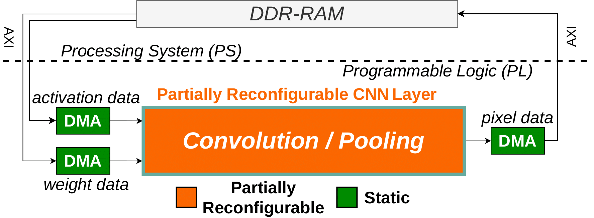
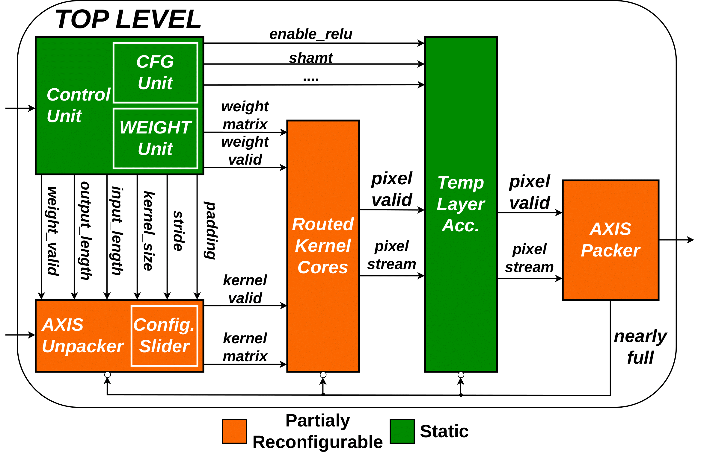

# Adaptive CNN Hardware Accelerator

This repository contains all code and evaluation results for a hardware accelerated adaptive CNN architecture, implementing fine-granular, partial reconfigurable CNN layers (Convolution & Pooling). This project was developed over the course of my bachelor thesis at FAU (Friedrich-Alexander University Erlangen-Nuremberg).

The partially reconfigurable CNN design is integrated in such a way that it can be controlled via the Processing System (PS) of the target FPGA, where the PS manages the pixel and weight streams sent to the Programmable Logic (PL). The PL sends the new calculated stream back to the PS. The design was prototyped on the Ultra96-v2 evaluation platform.

The overall design of the integrated accelerator looks like the following:



This repository is structured as follows:

```bash
├── _generated                      # Logging of various utilities
├── bdf                             # Bord definition files for the Ultra96-v2 board
├── doc                             # Images for this ReadMe
├── measurements                    # Evaluation data and helper scripts
├── reference
│   ├── simulation                  # The reference implementation of the AlexNet architecture
│   └── training                    # Scripts and data used to train a quantized AlexNet model
├── scripts
│   ├── code_generation             # Python Code Generation Framework to generate various modules
│   ├── simulation                  # Bash scripts for simulating legacy test benches
│   └── VivadoProject               # TCL scripts for creating the various Vivado Projects
├── sim_1                           # VHDL test benches (pure VHDL TB + VUnit TB)
├── sources_1                       # VHDL main sources for the hardware accelerator
├── SW-Integration
│   ├── src                         # Template code to implement software drivers
│   │   ├── convolution             # Template software driver for a convolution layer
│   │   └── pooling                 # Template software driver for a pooling layer
│   └── Vivado                      # Vivado project used to develop the hardware accumulator
├── wave_config                     # Wave Configuration Files for legacy test benches
└── INIT.sh                         # Init script for initializing repository with virtual environment
```

## Author

* Maxim Balajan

## Adaptive CNN Accelerator Usage

### Prerequisites

* **Vivado Version:** v2023.2
* **Vitis Version:** v2023.2
* Newest Version of [**PyEnv**](https://github.com/pyenv/pyenv) [*Tested with PyEnv 2.6.4*]
* Serial monitor such as `minicom`, `picocom` or `putty`

### 0. Initialize Repository

1. Install Python 3.10.XX using PyEnv
```bash
$ pyenv install 3.10.16
```
2. Source the INIT.sh script from project root
```bash
$ source ./INIT.sh
```
3. This creates various environmental variables needed for TCL and Python scripts and install a virtual Python environment \
**Note:** This can take some time for the first run, because it installs all packages necessary, later runs will be instant. So grab yourself a coffee in the meantime ;)

### 1. Create new CNN Layer (optional)
1. Create new folder under sources and change into that folder:
```bash
$ mkdir $PRJ_ROOT_PATH/sources_1/alex_net_layers/<Layer-Name>
$ cd $PRJ_ROOT_PATH/sources_1/alex_net_layers/<Layer-Name>
```
2. Create new *config.yaml* file that configures the new layer (orient yourself at [existing layers](sources_1/alex_net_layers/))
3. Create generated VHDL code with the [Python Code Generation Framework](scripts/code_generation/adder_tree_gen.py):
```bash
$ prj_adder_gen -c config.yaml -d .
``` 

4. After that, create a new Vivado TCL script (orient yourself at [existing scripts](scripts/VivadoProjects/)):
```bash
$ mkdir $PRJ_ROOT_PATH/scripts/VivadoProjects/<Layer-Name>
$ cd $PRJ_ROOT_PATH/scripts/VivadoProjects/<Layer-Name>
$ nano create_project.tcl
$ [...]
```

**Note**: Depending on the resource utilization of the layer, the maximum achievable frequency could be different. For that, either create a new block design with different PLL parameters or use on of the provided Block design TCL scripts. 250MHz should always work...

### 2. Create Vivado Project and Synthesize/Implement Design
1. Change into the Folder containing the TCL script and open Vivado:
```bash
$ cd $PRJ_ROOT_PATH/scripts/VivadoProjects/<Layer-Name>/
$ vivado -nolog -nojournal -mode tcl
```
2. Source the *create_project.tcl* file. This will create the project and start the synthesis/implementation:
```bash
Vivado% source ./create_project.tcl
```
3. After implementation, this should create a *Hardware-Definition.xsa* file with which the design can be brought to the evaluation platform

### 3. Create Vitis Platform + Application

1. Create a new Vitis platform from the generated XSA files and build it \
**Note**: Make sure that stdout is mapped to the right output interface (e.g. for Ultra96-v2 you need to select UART1 instead of UART0).
2. Create a new, empty application utilizing the previously created platform
3. Populate the source files provided in `SW-Integration/src/{convolution | pooling}/` with the correct layer configurations
```cpp
    // 16 bit registers
    ((u16 *)cfg_ptr)[0] = $$TBD$$;                                               // Input Image Size
    ((u16 *)cfg_ptr)[1] = $$TBD$$;                                               // Output Image Size
    ((u16 *)cfg_ptr)[2] = $$TBD$$;                                               // Input Channel Size
    ((u16 *)cfg_ptr)[3] = $$TBD$$;                                               // Output Channel Size
    ((u16 *)cfg_ptr)[4] = ((u16 *)cfg_ptr)[1] * ((u16 *)cfg_ptr)[1];             // Output Image Size Squared
    ((u16 *)cfg_ptr)[5] = $$TBD$$;                                               // Concurrent Channel Amount
    // 8 bit registers
    cfg_ptr[12] = $$TBD$$;                                                        // Kernel Size
    cfg_ptr[13] = $$TBD$$;                                                        // Padding
    cfg_ptr[14] = $$TBD$$;                                                        // Stride Bit Mask (0, 1, 3, 7, ...)
    cfg_ptr[15] = $$TBD$$;                                                        // Shamt[6:2] + ReLU[1] + Mode[0]
```
4. Build the application
4. Power on the FPGA and connect it via UART/JTAG.
6. Build the application and flash the device. \
*Optional*: If you want to capture the latencies of the benchmark, just run `cd $PRJ_ROOT_PATH/measurements && python record_output.py`. This will connect to the serial output of `/dev/ttyUSB1` at baud rate `115200` and put all measured latency in a csv file. With this script you can still see the output as if you were connected with e.g. `minicom`, `picocom`, `putty`, etc.
7. *Optional*: If benchmarks provided in `cd $PRJ_ROOT_PATH/measurements` want to be recreated, alter the software driver so that it changes the configuration values after each run (with e.g. a global for-loop)

### A. Architecture Overview

The Adaptive CNN hardware accelerator is implemented as follows:



For more information, please have a look at the [sources_1/](sources_1/) directory.

### B. Run Top-Level Testbenches (VUnit)

0. Change the simulator given by the INIT.sh script and source it from project root
```bash
$ nano ./INIT.sh
$ [...]
$ source ./INIT.sh
```
1. Change into the specified Top-Level Folder:
```bash
$ cd $PRJ_ROOT_PATH/sources_1/alex_net_layers/<Layer-Name>
```
2. Run the provided *run_vunit.py* file, providing the specified Test Case (TC-Name given by *--list*):
```bash
$ python run_vunit.py <TC-Name> --gui
```
**Note:** Currently most test benches are not self-testing, meaning they have to verified via the waveform

### C. Run Legacy Testbenches (XSim)

0. Source the INIT.sh script from project root
```bash
$ source ./INIT.sh
```
1. Run the test benches by providing the bash functions provided by the *INIT.sh* script:
```bash
$ prj_simulate_<tb_name>
```
2. To get a listing of all test benches, run:
```bash
$ prj_simulate_help
```
**Note:** Currently most test benches are not self-testing, meaning they have to verified via the waveform

## Training and Reference Inference (on Desktop)

### Requirements

* Newest Version of [**PyEnv**](https://github.com/pyenv/pyenv) [*Tested with PyEnv 2.6.4*]
* C++ 23
* CMake 3.20.0
* Protobuf (tested with version *3.21.12-9ubuntu1*, probably usable with older versions as well)

To install the required packages on Ubuntu, run: `sudo apt install cmake build-essential protobuf-compiler`

### Training

0. Source the INIT.sh script from project root
```bash
$ source ./INIT.sh
```
1. To train, run the [training script](reference/training/training.py):
```bash
$ prj_train --help
```

### Reference Inference

0. Source the INIT.sh script from project root
```bash
$ source ./INIT.sh
```

1. To build the [reference inference](reference/simulation/) using GNU Make and running it afterwards, execute:

```bash
$ prj_build_simulation
$ prj_run_simulation --help
```
